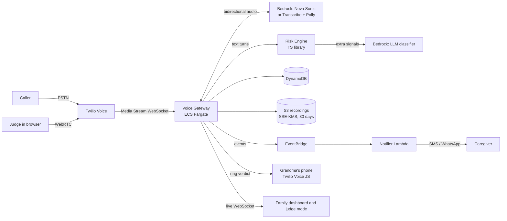
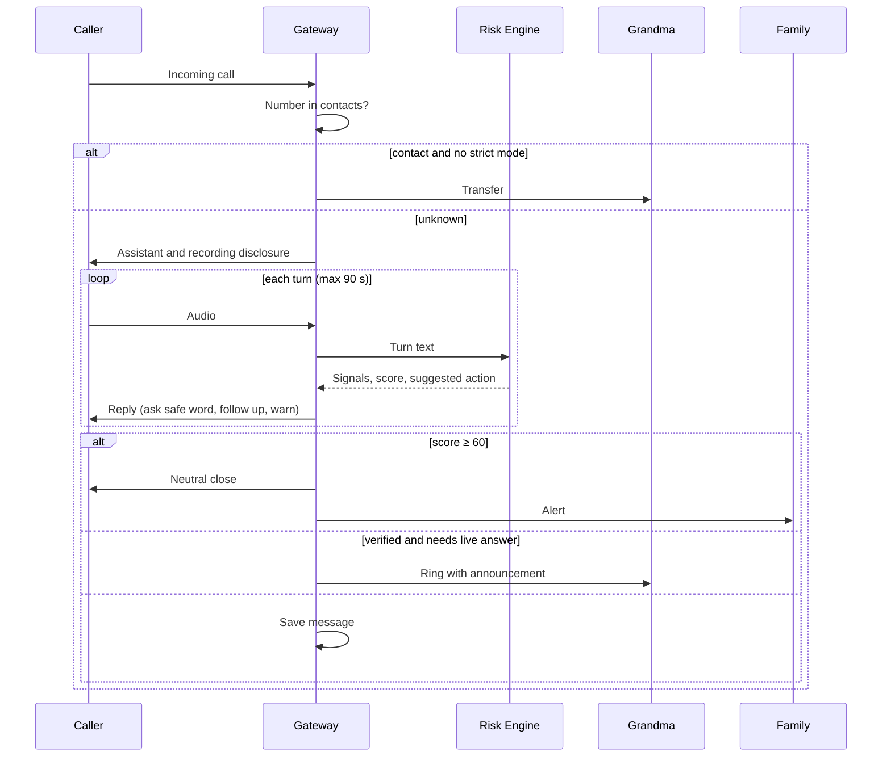

# Design — After the Beep

## Overview

Three pieces: a **voice gateway** that answers the call and talks in real time, a pure and testable **risk engine** that turns turns into signals and a score, and **three web interfaces** (family dashboard, protected person's phone, and judge mode) that share a design system inspired by a 1987 answering machine.

Key decision: the risk engine is a library with no network dependencies. Rules always decide; the language model only adds signals. That way the system keeps working if the model fails (Req. 4.6) and can be verified with property-based testing.

## Architecture



### Call flow



## Components

### 1. Telephony (Twilio)
- The protected person's public number forwards unconditionally to the household's Twilio number (carrier call forwarding).
- The phone that actually rings is a web app built on the Twilio Voice JS SDK (or a private second line only the system knows). For the hackathon the web app is enough and demos well on video.
- Judge mode: Twilio Voice JS SDK from the browser to the same gateway, using the demo household.

### 2. Voice Gateway (TypeScript, Node 20, ECS Fargate)
- Receives Twilio Media Streams (μ-law 8 kHz) over WebSocket and forwards them to the speech engine.
- Speech engine, option A: Amazon Nova Sonic (bidirectional speech-to-speech on Bedrock). **Verify Spanish support and region availability in week 1.**
- Option B (fallback): Amazon Transcribe streaming + Claude on Bedrock for the reply + Amazon Polly neural voices.
- Keeps call state in memory and persists it when each turn closes.
- Publishes `call.turn`, `call.score`, `call.verdict` events over WebSocket to the interfaces and over EventBridge to the notifier.
- The agent prompt lives in `prompts/agent.md` and never contains the safe word; verification happens in the risk engine.

### 3. Risk Engine (`packages/risk-engine`, pure TypeScript)
Interface:

```ts
type Turn = { speaker: "caller" | "machine"; text: string; atMs: number };
type Signal = { id: SignalId; weight: number; evidence: string; source: "rule" | "llm" };
type Assessment = {
  score: number;               // 0–100
  signals: Signal[];           // unique by id
  action: "continue" | "ask_safe_word" | "warn_code" | "block" | "ring" | "message";
  safeWordAttempts: number;
};
function assess(prev: Assessment, turn: Turn, ctx: HouseholdContext, llm?: Signal[]): Assessment;
```

- **Rules:** patterns and phrase lists in English and Spanish for each signal in Appendix A.
- **Safe word:** normalization (lowercase, no accents, no punctuation) and Levenshtein distance ≤ ⌊len/6⌋ (Req. 3.2). Receives the decrypted word in memory only.
- **LLM classifier:** Claude on Bedrock with strict JSON output `{signals:[{id, evidence}]}`. It may only propose catalog ids; the engine assigns weights. 2 s timeout.
- **Thresholds:** block ≥ 60; ring < 30 when a live answer is needed; otherwise save message.

### 4. Notifier (Lambda)
- Consumes `call.verdict` events with `block`.
- Alert template with: who was impersonated, what was requested, signals, suggested action, and link (Req. 6.2).
- Channel: Twilio SMS for the MVP; WhatsApp as an improvement.

### 5. Web interfaces (React + Vite, deployed on S3 + CloudFront)
- **Family dashboard:** 5-step guided setup, history, call detail with transcript, and a "This call was misclassified" button.
- **Grandma's phone:** single screen, large type, announcement before connecting, LED message counter.
- **Judge mode:** the HTML demo turned into a live app: machine, meter, transcript, and signals in real time, plus 4 suggested scripts.

## Data model (DynamoDB, single table)

| PK | SK | Attributes |
|---|---|---|
| `HH#<id>` | `META` | protected person name, Twilio number, strict mode, `safeWordCipher` (KMS) |
| `HH#<id>` | `CONTACT#<e164>` | name, relationship |
| `HH#<id>` | `CAREGIVER#<id>` | name, phone, channel |
| `HH#<id>` | `CALL#<ts>#<callSid>` | number, duration, verdict, score, signals, masked transcript, `recordingKey` |
| `HH#<id>` | `FEEDBACK#<callSid>` | correct verdict, note |

Access per household via Cognito: `householdId` comes from the token, never from the client (Req. 9.3).

## Design system

The published demo is the visual reference. Concept: a 1987 almond-plastic answering machine that traps ghosts. The scam is the ghost and the tape locks it in.

### Tokens

| Token | Light | Dark | Use |
|---|---|---|---|
| `--page` | `#E4DEEC` | `#1A1528` | Background: lilac dusk or plum night |
| `--ink` | `#231A31` | `#EEE7F6` | Primary text |
| `--panel` | `#F4F0F8` | `#241D35` | Cards and buttons |
| `--plastic` | `#DCD2BF` | `#CDC3AF` | Machine body |
| `--smoke` | `#26211C` | `#26211C` | Smoked acrylic, displays |
| `--led` | `#FF3B2F` | `#FF3B2F` | Counter, alert, block |
| `--amber` | `#FFB547` | `#FFB547` | VFD display text |
| `--jade` | `#22A37A` | `#22A37A` | Verified, safe call |

### Typography
- **Doto** (dot matrix): title, LED counter, large figures. Never for paragraphs.
- **Bricolage Grotesque**: everything else. Scale 14 / 17 / 22 / 28 / 40+.
- On grandma's phone, body text at least 28 px.

### Components
- **Machine:** beveled body, cassette window with reels spinning while recording, LED counter, status lamp (off, blinking red = incoming, red = blocked, jade = verified).
- **VU meter:** needle from −60° to +60°, red zone from 60 points. This is the memorable element: it must be visible in the first second of the video.
- **VFD display:** transcript in amber, caller in light amber, machine in aqua green.
- **Signal chip:** red with "+weight" or green with "−weight".
- **Verdict:** soft red background for blocks, soft jade for ring or message, with a bubble showing the message sent.

### Motion and sound
- A single orchestrated moment: the verdict (needle, lamp, ghost on the tape, sound).
- Period sounds: 440+480 Hz ring, 1 kHz beep before recording, three descending tones when trapping.
- `prefers-reduced-motion` disables reels, blinking, and the ghost's float.

### Product voice
- The machine speaks politely in short sentences and never accuses: it closes with "I'll pass your message to the family."
- Alerts always end with one concrete action.

## Error handling

| Failure | Behavior |
|---|---|
| Speech engine down | Period-style recorded message: "Please leave a message after the beep"; saved as message |
| LLM slow or down | Rules only (Req. 4.6) |
| Notifier fails | Retry with backoff 3 times; then mark the call "alert pending" in the dashboard |
| Grandma doesn't answer after ringing | Save message and notify the caregiver if the call was verified |
| Safe word not configured | Guided setup cannot be completed |

## Testing strategy

### Property-based testing (fast-check) on the Risk Engine
1. The score is always within [0, 100].
2. Adding a turn with a positive signal never lowers the score.
3. The same signal repeated never counts twice.
4. Saying the correct safe word never leaves a call at `block` unless other signals reach ≥ 60.
5. The safe word never appears in the stored transcript or in any output message.
6. With the LLM down, the result equals the rules-only result.

### Evaluation
- `evals/scripts.jsonl`: 60+ labeled scripts (Req. 12) with turns and expected verdict.
- `npm run eval` reports scam detection, false positives, and a confusion matrix by typology.

### End to end
- Simulated call with pre-recorded TTS audio against the gateway in staging, measuring p50 and p95 latency.

## Kiro usage (for the write-up)
- **Specs:** this spec drives development; every task references requirements.
- **Steering:** product, stack, structure, and a voice guide for older adults.
- **Hooks:** automatic evaluation when rules or prompts change; property tests on save of the engine; safe-word leak guard.
- **MCP:** AWS documentation and, if available, the Twilio MCP server to configure numbers and flows from Kiro.
