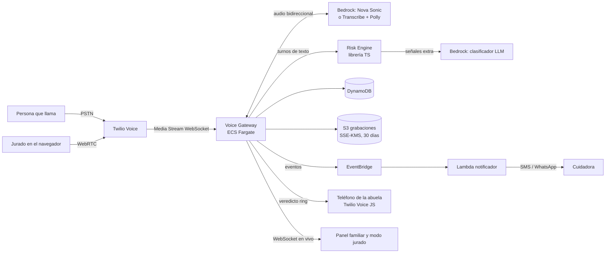
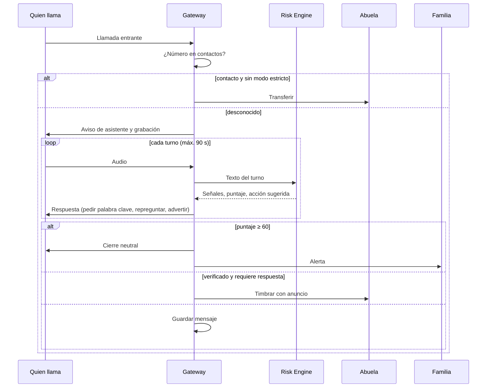

# Diseño — After the Beep

## Resumen

Tres piezas: un **gateway de voz** que atiende la llamada y conversa en tiempo real, un **motor de riesgo** puro y testeable que convierte turnos en señales y puntaje, y **tres interfaces web** (panel familiar, teléfono de la persona protegida y modo jurado) que comparten un sistema de diseño inspirado en un contestador de 1987.

Decisión clave: el motor de riesgo es una librería sin dependencias de red. Las reglas deciden siempre; el modelo de lenguaje solo agrega señales. Así el sistema funciona aunque el modelo falle (Req. 4.6) y se puede probar con property-based testing.

## Arquitectura



### Flujo de una llamada



## Componentes

### 1. Telefonía (Twilio)
- El número público de la persona protegida se desvía de forma incondicional al número Twilio del hogar (desvío del operador).
- El teléfono que sí timbra es una app web con Twilio Voice JS SDK (o una segunda línea privada que solo conoce el sistema). Para el hackathon, la app web basta y se puede demostrar en video.
- Modo jurado: Twilio Voice JS SDK desde el navegador hacia el mismo gateway, con el hogar de demostración.

### 2. Voice Gateway (TypeScript, Node 20, ECS Fargate)
- Recibe Twilio Media Streams (μ-law 8 kHz) por WebSocket y los reenvía al motor de voz.
- Motor de voz, opción A: Amazon Nova Sonic (speech-to-speech bidireccional en Bedrock). **Verificar en la semana 1 el soporte de español y la región disponible.**
- Opción B (respaldo): Amazon Transcribe streaming (es-US) + Claude en Bedrock para la respuesta + Amazon Polly neural en español.
- Mantiene el estado de la llamada en memoria y lo persiste al cerrar cada turno.
- Publica eventos `call.turn`, `call.score`, `call.verdict` por WebSocket a las interfaces y por EventBridge al notificador.
- El prompt del agente vive en `prompts/agent.es.md` y nunca incluye la palabra clave; la verificación la hace el motor de riesgo.

### 3. Risk Engine (`packages/risk-engine`, TypeScript puro)
Interfaz:

```ts
type Turn = { speaker: "caller" | "machine"; text: string; atMs: number };
type Signal = { id: SignalId; weight: number; evidence: string; source: "rule" | "llm" };
type Assessment = {
  score: number;               // 0–100
  signals: Signal[];           // únicas por id
  action: "continue" | "ask_safe_word" | "warn_code" | "block" | "ring" | "message";
  safeWordAttempts: number;
};
function assess(prev: Assessment, turn: Turn, ctx: HouseholdContext, llm?: Signal[]): Assessment;
```

- **Reglas:** expresiones y listas de frases en español colombiano, mexicano y neutro por cada señal del Anexo A.
- **Palabra clave:** normalización (minúsculas, sin tildes, sin puntuación) y distancia de Levenshtein ≤ ⌊len/6⌋ (Req. 3.2). Recibe la palabra descifrada solo en memoria.
- **Clasificador LLM:** Claude en Bedrock con salida JSON estricta `{signals:[{id, evidence}]}`. Solo puede proponer ids del catálogo; los pesos los pone el motor. Timeout de 2 s.
- **Umbrales:** bloquear ≥ 60; timbrar < 30 con necesidad de respuesta en vivo; si no, mensaje.

### 4. Notificador (Lambda)
- Consume `call.verdict` con `block`.
- Plantilla de alerta con: suplantado, pedido, señales, acción sugerida y enlace (Req. 6.2).
- Canal: SMS de Twilio en el MVP; WhatsApp como mejora.

### 5. Interfaces web (React + Vite, desplegadas en S3 + CloudFront)
- **Panel familiar:** configuración guiada de 5 pasos, historial, detalle de llamada con transcripción y botón "Esta llamada estaba mal clasificada".
- **Teléfono de la abuela:** pantalla única, letra grande, anuncio antes de conectar, contador LED de mensajes.
- **Modo jurado:** el demo HTML convertido en app viva: máquina, medidor, transcripción y señales en tiempo real, más 4 guiones sugeridos.

## Modelo de datos (DynamoDB, tabla única)

| PK | SK | Atributos |
|---|---|---|
| `HH#<id>` | `META` | nombre persona protegida, número Twilio, modo estricto, `safeWordCipher` (KMS) |
| `HH#<id>` | `CONTACT#<e164>` | nombre, relación |
| `HH#<id>` | `CAREGIVER#<id>` | nombre, teléfono, canal |
| `HH#<id>` | `CALL#<ts>#<callSid>` | número, duración, veredicto, puntaje, señales, transcripción enmascarada, `recordingKey` |
| `HH#<id>` | `FEEDBACK#<callSid>` | veredicto correcto, nota |

Acceso por hogar con Cognito: el `householdId` sale del token, nunca del cliente (Req. 9.3).

## Sistema de diseño

El demo publicado es la referencia visual. Concepto: un contestador de plástico almendra de 1987 que atrapa fantasmas, la estafa es el fantasma y la cinta lo encierra.

### Tokens

| Token | Claro | Oscuro | Uso |
|---|---|---|---|
| `--page` | `#E4DEEC` | `#1A1528` | Fondo, crepúsculo lila o noche ciruela |
| `--ink` | `#231A31` | `#EEE7F6` | Texto principal |
| `--panel` | `#F4F0F8` | `#241D35` | Tarjetas y botones |
| `--plastic` | `#DCD2BF` | `#CDC3AF` | Cuerpo de la máquina |
| `--smoke` | `#26211C` | `#26211C` | Acrílico ahumado, pantallas |
| `--led` | `#FF3B2F` | `#FF3B2F` | Contador, alerta, bloqueo |
| `--amber` | `#FFB547` | `#FFB547` | Texto de la pantalla VFD |
| `--jade` | `#22A37A` | `#22A37A` | Verificado, llamada segura |

### Tipografía
- **Doto** (matriz de puntos): título, contador LED, cifras grandes. Nunca para párrafos.
- **Bricolage Grotesque**: todo lo demás. Escala 14 / 17 / 22 / 28 / 40+.
- En el teléfono de la abuela, cuerpo mínimo 28 px.

### Componentes
- **Máquina:** cuerpo con biseles, ventana de casete con carretes que giran mientras graba, contador LED, lámpara de estado (apagada, roja parpadeante = entrante, roja = bloqueada, jade = verificada).
- **Medidor VU:** aguja de −60° a +60°, zona roja desde 60 puntos. Es el elemento memorable: debe verse en el primer segundo del video.
- **Pantalla VFD:** transcripción en ámbar, quien llama en ámbar claro, el contestador en verde agua.
- **Chip de señal:** rojo con "+peso" o verde con "−peso".
- **Veredicto:** fondo rojo suave para bloqueo, jade suave para timbre o mensaje, con burbuja del mensaje enviado.

### Movimiento y sonido
- Un único momento orquestado: el veredicto (aguja, lámpara, fantasma en la cinta, sonido).
- Sonidos de época: timbre 440+480 Hz, pitido de 1 kHz antes de grabar, tres tonos descendentes al atrapar.
- `prefers-reduced-motion` apaga carretes, parpadeos y flotación del fantasma.

### Voz del producto
- El contestador habla de usted, frases cortas, nunca acusa: cierra con "Le dejo el mensaje a la familia".
- Las alertas siempre terminan con una acción concreta.

## Manejo de errores

| Falla | Comportamiento |
|---|---|
| Motor de voz caído | Mensaje grabado de época: "Deje su mensaje después del tono"; se guarda como mensaje |
| LLM lento o caído | Solo reglas (Req. 4.6) |
| Notificador falla | Reintento con backoff 3 veces; luego marca la llamada como "alerta pendiente" en el panel |
| La abuela no contesta tras timbrar | Se guarda mensaje y se avisa a la cuidadora si la llamada era verificada |
| Palabra clave no configurada | El sistema no permite terminar la configuración guiada |

## Estrategia de pruebas

### Property-based testing (fast-check) sobre el Risk Engine
1. El puntaje siempre está en [0, 100].
2. Agregar un turno con una señal positiva nunca baja el puntaje.
3. La misma señal repetida no suma dos veces.
4. Decir la palabra clave correcta nunca deja una llamada en `block` si no hay otras señales ≥ 60.
5. La palabra clave nunca aparece en la transcripción guardada ni en ningún mensaje de salida.
6. Con LLM caído, el resultado es igual al de solo reglas.

### Evaluación
- `evals/scripts.jsonl`: 60+ guiones etiquetados (Req. 12) con turnos y veredicto esperado.
- `npm run eval` reporta detección de estafas, falsos positivos y matriz de confusión por tipología.

### Extremo a extremo
- Llamada simulada con audio TTS pregrabado contra el gateway en staging, midiendo latencia p50 y p95.

## Uso de Kiro (para el write-up)
- **Specs:** este spec maneja el desarrollo; cada tarea referencia requisitos.
- **Steering:** producto, stack, estructura, y una guía de voz para adultos mayores.
- **Hooks:** evaluación automática al cambiar reglas o prompts; tests de propiedades al guardar el motor; escaneo de secretos antes de commit.
- **MCP:** documentación de AWS y, si está disponible, el servidor MCP de Twilio para configurar números y flujos desde Kiro.
